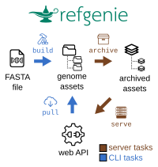

# Refgenie overview

## Motivation

Reference genome assemblies are the starting point for many downstream tools, such as sequence alignment and annotation. Many tools produce assets that go with a genome assembly; for instance, aligners like `bwa` or `bowtie2` build *indexes* of the genome to speed up alignment. Research groups often keep a central folder of these indexes and other files like annotations, which saves disk space and makes it easy to share software within the group. A uniform folder structure also lets software switch from one assembly to the next. But each group usually builds this structure on its own. A standard shared across groups would make scripts and software that use genome resources easier to share.

Illumina's *IGenomes* project distributes pre-built archives of common assets for common genomes. This gives many groups one standard, but it has limits. It provides no software to build the same structure for an arbitrary genome, and we often need a custom genome, such as a spike-in control or a personal assembly. It also packages many resources into one archive, so you cannot download just the asset you need.

### Functionality

**Refgenie gives you structured, scripted builds and itemized access to pre-built assets in the same system.** It provides two ways to get genome assets (see figure at right):

  1. Web access to individual pre-built assets, through a web interface or an API.
  2. Scripted asset "builds," each of which produces structured output for any input genome.

Either way, you get *identically structured* outputs for *any genome*, including new, private, or custom assemblies that no public server will have.

## Refgenie ecosystem

Refgenie is a single Python package that manages, builds, serves, and distributes reference genome assets.

### The `refgenie` command-line interface (CLI)

`pip install "refgenie>=1.0.0a1"` provides the `refgenie` command, which you use to `pull` or `build` an asset. You can also use refgenie from Python through its API. See the [Python API reference](code/refgenie.md).

### Built-in server

`refgenie serve` starts a server with a web interface and a REST API, which the CLI and other tools use to list and download assets. We host a public instance at [api.refgenie.org](https://api.refgenie.org), and you can run your own. See the [server documentation](server/README.md).

### Database backends

| Backend | Use case | Setup |
|---|---|---|
| **SQLite** (default) | Single-user workstations, local development | Works out of the box |
| **PostgreSQL** | Multi-user servers, production deployments, cloud | Needs a PostgreSQL server; configured with a YAML file |

See [Database backends](database.md).

### RefgetStore

When you initialize a genome with `refgenie genome init`, refgenie loads its sequences into a local **RefgetStore**, a content-addressable store where each sequence is identified by its GA4GH digest. The store removes duplicate sequences across genomes, lets you retrieve subsequences with `refgenie getseq`, and verifies genome identity. See [Genome initialization and the RefgetStore](genome_tutorial.md).

### Data channels

**Data channels** are external sources of asset classes and recipes. They let anyone publish and share new asset types and build instructions. See [Data channels](data_channels.md).

### Staging and remote storage

Built assets can be **staged** for serving and then **pushed** to remote storage like S3. Staging prepares assets according to their serving modes (file or archive). See [Stage assets for serving](staging.md) and [Configure remote storage](remotes.md).
